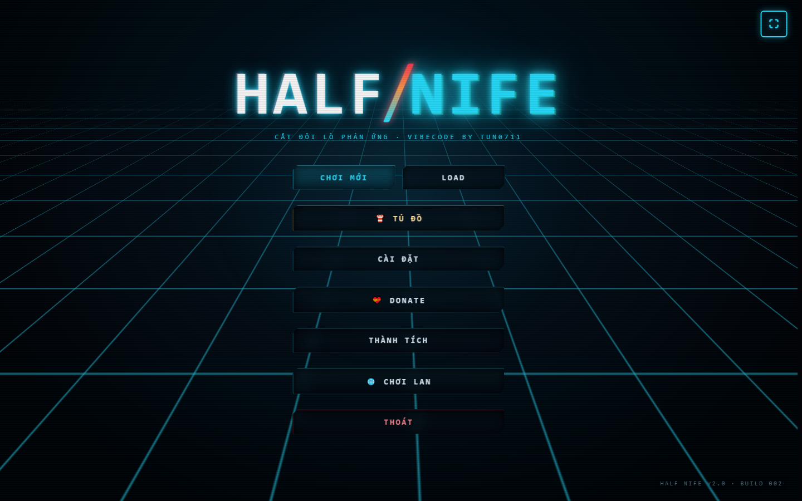
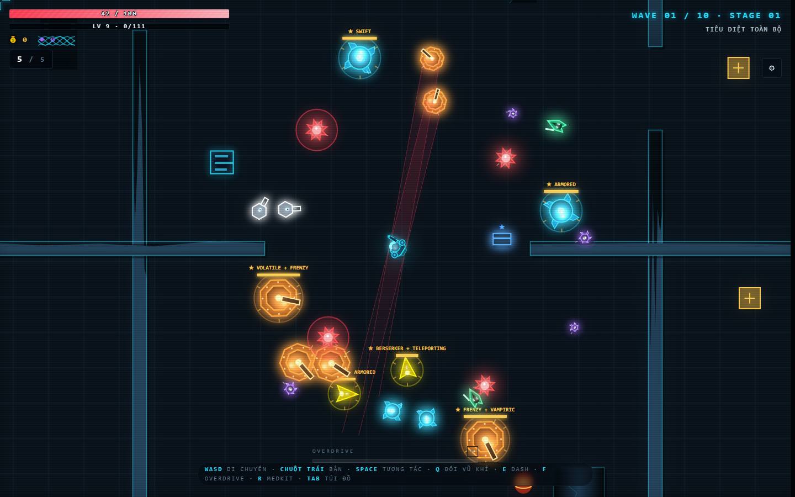
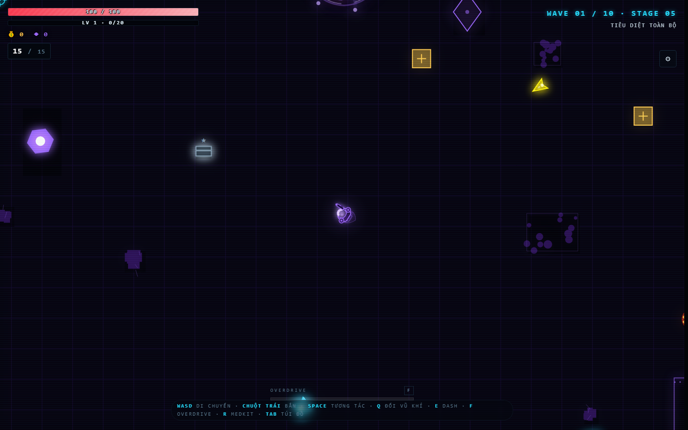
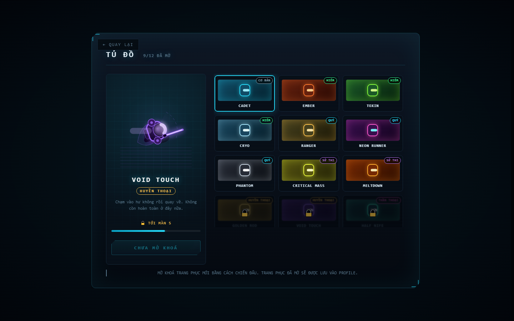

# HALF NIFE

**Roguelite bắn sinh tồn góc nhìn từ trên xuống, lấy bối cảnh một lò phản ứng đã chết.**

Repo `VNXX` là nguồn phát hành của **HALF NIFE v2.0.0 (build 002)** — game chạy hoàn toàn trên trình duyệt, không engine, không dependency, không cần build.

<p align="center">
  
</p>

| | | |
|---|---|---|
|  |  |  |

---

## Tính năng

### Combat & roguelite
- **5 màn chơi**, mỗi màn 10 wave + một boss riêng: `ABANDONED FACILITY` → `INDUSTRIAL ZONE` → `NEON CITY` → `DEAD SECTOR` → `VOID CORE`.
- **5 boss** với hệ thống attack v2: random có trọng số, telegraph báo đòn, 3 phase, summon, cửa sổ punish và bảng hệ số riêng theo 4 độ khó.
- **20 vũ khí** (cận chiến, súng, súng phun, railgun, arcgun...) với crit, xuyên, splash, burst, nạp đạn và hiệu ứng trạng thái khi trúng.
- **17 loại địch** với 11 AI khác nhau (chase, ranged, assassin, exploder, charger, sniper, summoner, brute, turret, burrow, support), kèm **11 elite affix**, giáp (`armor`), thanh cân bằng (`poise`) và cơ chế **BREAK**.
- **53 thẻ nâng cấp** khi lên level, gồm cả thẻ build-defining có đánh đổi.
- **Combo** (mỗi stack cộng sát thương/credit/XP, mất một nửa khi dính đòn), **Overdrive** (nạp bằng damage/kill/né hoàn hảo, bật bằng `F`), status effects, chain lightning, execute, hazards và map sinh ngẫu nhiên theo 5 layout.
- **6 wave event** ngẫu nhiên: BLOOD, SWARM, ELITE_HUNT và các biến thể khác.

### Tiến trình & meta
- **Shop 3 tab**: cửa hàng credits, cửa hàng Hư Không (void shards), bán đồ; rarity 6 cấp từ COMMON đến MYTHIC; reroll leo thang theo tier.
- **6 module** (tối đa 4 slot) và **7 consumable** dùng được trong trận.
- **12 trang phục** có điều kiện mở khó riêng, xem trước trực tiếp trong **Tủ đồ**.
- **10 thành tích** lưu vĩnh viễn theo thống kê profile.
- **4 độ khó**: DỄ, TRUNG BÌNH, KHÓ, HARDCORE (chết là kết thúc, không revive, save bị đánh dấu vĩnh viễn).
- Lưu tối đa **8 slot** bằng `localStorage`, auto-save, validate + migrate schema, lưu stats/profile/meta riêng.

### Khác
- **Co-op LAN** qua WebSocket relay tự cài trong `server.js`, **không cần thư viện ngoài**, tối đa 4 người / phòng.
- Đồ họa 2D canvas với tùy chọn **2.5D** (bóng đổ + ánh sáng), hiệu ứng hạt, rung màn hình, particle menu.
- Chế độ **mobile** với joystick + nút cảm ứng, chặn zoom/scroll khi đang chơi.
- Settings đầy đủ: SFX/nhạc/hiệu ứng/3D/shake/mobile, 3 slider âm lượng, bật lại tutorial, chế độ hiệu năng, báo lỗi kèm debug info, xóa toàn bộ dữ liệu.
- Console debug: `VNXX.cmd.help()` hoặc `HALFNIFE.cmd.help()`.

---

## Chạy game

Game dùng **ES modules**, nên phải mở qua HTTP — mở trực tiếp `index.html` bằng `file://` sẽ bị browser chặn import.

### Cách 1 — server đi kèm (khuyến nghị)

```bash
node server.js          # http://localhost:3000
node server.js 8080     # đổi cổng
```

`server.js` vừa phục vụ file tĩnh, vừa làm WebSocket relay cho chế độ LAN. Yêu cầu **Node.js 18+**.

### Cách 2 — static server bất kỳ

```bash
python -m http.server 3000
# hoặc
npx serve .
```

Sau đó mở `http://localhost:3000`.

> Không có bước cài đặt hay build. Mọi file CSS/JS đều được trình duyệt nạp trực tiếp.

---

## Chơi LAN

1. Máy **host** chạy `node server.js`.
2. Các máy cùng mạng mở `http://<IP-của-host>:3000`.
3. Vào menu **CHƠI LAN** → host bấm **TẠO PHÒNG**, guest nhập mã 4 ký tự rồi bấm **VÀO PHÒNG**.
4. Mỗi phòng tối đa **4 người** (1 host + 3 guest). Đóng phòng khi host thoát.

WebSocket được implemented trực tiếp theo RFC 6455 trong `server.js`; client tương ứng nằm ở `js/systems/net.js`.

---

## Điều khiển

| Hành động | Phím |
|---|---|
| Di chuyển | `W A S D` / `↑ ← ↓ →` |
| Ngắm | Chuột |
| Tấn công (giữ) | Chuột trái |
| Tương tác / mở rương | `Space` |
| Đổi vũ khí | `Q` |
| Dash | `E` |
| Overdrive | `F` |
| Dùng Medkit | `R` |
| Túi đồ | `Tab` |
| Chọn nâng cấp | `1` / `2` / `3` |
| Tạm dừng | `Esc` |
| Debug panel | `F3` |

Trên mobile bật **CHẾ ĐỘ MOBILE (JOYSTICK)** trong Settings để hiện joystick và 4 nút cảm ứng (túi đồ, dash, tương tác, tấn công).

---

## Cấu trúc nguồn

```text
index.html              Toàn bộ UI: 19 màn hình, HUD, menu, shop, LAN, wardrobe
server.js               Static server + WebSocket relay cho LAN (zero dependency)
css/                    base, screens, menu, hud, lan, mobile, combat, wardrobe, fx-ui, polish
js/
  main.js               Entry point — bootstrap, global hooks, window.VNXX / window.HALFNIFE
  core/                 constants, input, settings, utils
  data/                 weapons, enemies, bosses, stages, upgrades, skins, modules,
                        consumables, achievements, wave-events, shop
  game/                 game, world, player, enemy, boss, projectile, waves, loot,
                        progress, mapgen, hazards, overdrive, boss-attacks, boss-summon, boss-v2
  render/               canvas, draw-world, draw-entities, draw-fx, draw-combat, render3d
  systems/              save, sound, music, fx, combo, status, net, wardrobe, menu-fx
  ui/                   menus, hud, screens, shop-ui, inventory-ui, lan-ui,
                        wardrobe-ui, mobile-ui
  debug.js              Console commands (VNXX.cmd.*)
assets/                 QR ủng hộ
screenshots/            Ảnh chụp màn hình
tests/                  audit / smoke / gfx script (dùng cho dev)
```

### Chỉnh balance

Mọi con số gameplay nằm riêng trong `js/data/*` và `CFG` ở `js/core/constants.js`. Comment đầu mỗi file data mô tả rõ field. Đổi xong reload trình duyệt là áp dụng, không cần build.

---

## Save & dữ liệu

- Slot lưu: `VNXX_SAVE_1` … `VNXX_SAVE_8` trong `localStorage`.
- Cài đặt: `VNXX_SETTINGS`; meta/thành tích: `VNXX_META`.
- Auto-save khi rời trang. Nút **XÓA TOÀN BỘ DỮ LIỆU** trong Settings xóa sạch các key trên.
- Save schema version 2, tự migrate save cũ khi đọc.

---

## Debug

Bật panel bằng `F3`, hoặc mở Console và gõ:

```js
VNXX.cmd.help()
```

Một vài lệnh hay dùng: `god()`, `givecash(n)`, `givexp(n)`, `levelup(n)`, `spawn(type, n)`, `spawnboss()`, `nextwave()`, `setstage(n)`, `giveweapon(id)`, `applyupgrade(id)`, `state()`, `info()`, `save()`, `fps()`.

---

## Test (dev)

```bash
node tests/audit.mjs   # kiểm tra HTML/ID/class/import/syntax CSS-JS, ghi tests/audit-report.json
node tests/smoke.mjs   # smoke test UI bằng headless Edge
node tests/gfx.mjs     # đo FPS/độ sáng, chụp ảnh so sánh 2.5D on/off
```

Hai script browser dùng `playwright-core` và đường dẫn Edge/Node cụ thể khai báo đầu file — chỉnh lại cho máy bạn trước khi chạy. Có thể đổi URL bằng biến môi trường `GAME_URL` (mặc định `http://localhost:3000`, riêng `gfx.mjs` dùng `http://localhost:3123`).

---

HALF NIFE · VIBECODE // TUN0711
